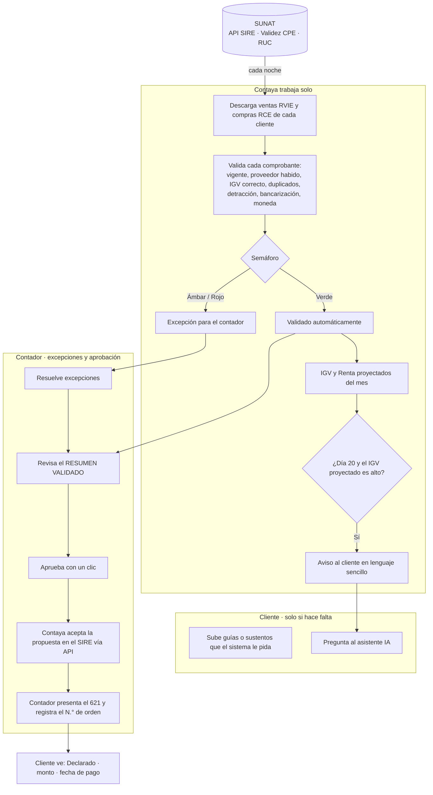

# Contaya — Modelo de proceso mensual (v2, aprobado 04/11/2026)

Principio: **automatizar al máximo; el contador solo revisa excepciones y aprueba.**
"Cero margen de error" = **cero errores silenciosos**: toda diferencia se detecta y se muestra; nada se declara sin el visto bueno del contador.

## Fuentes de datos

| Dato | Fuente principal | Respaldo |
|---|---|---|
| Ventas | **Propuesta RVIE del SIRE** (API SUNAT) | XML subido por el cliente / archivo exportado del SIRE |
| Compras | **Propuesta RCE del SIRE** (API SUNAT) | Archivo exportado del SIRE / XML puntual |
| Guías de remisión | XML de GRE subido por el cliente (Fase 3) | — |
| RUC del cliente y proveedores | Consulta RUC (Decolecta / OpenRUC) | Manual |

El cliente **ya no sube compras**. Solo ventas, notas de crédito y guías cuando el sistema se lo pida.
Todo comprobante electrónico pasa por SUNAT, por eso el SIRE trae lo emitido con SEE-SOL, con el sistema propio del cliente o con un OSE/PSE. Conectarse al sistema de facturación del cliente es opcional (solo para ver ventas en tiempo real).

## Flujo

## Semáforo (reglas en `lib/sire/semaforo.ts`, con pruebas)

- **Rojo** (bloquea): comprobante anulado o no válido; IGV que no cuadra con la base; boleta usada como crédito fiscal; RUC del proveedor no habido o de baja; duplicado.
- **Ámbar** (revisar): moneda extranjera sin tipo de cambio; emitido fuera del periodo; posible detracción sin constancia; monto ≥ S/ 2,000 sin medio de pago (bancarización); diferencia entre SIRE y XML del cliente.
- **Verde**: todo lo demás → se valida automáticamente con origen `sire`.

## Aviso "IGV alto" (día 20)

Solo sugiere **adelantar compras que el negocio igual iba a hacer** y que cumplan los requisitos del crédito fiscal (causalidad, factura electrónica, proveedor habido, bancarización, detracción). Nunca sugiere compras innecesarias: comprar S/ 118 para ahorrar S/ 18 es perder dinero.

## Credenciales SUNAT de cada cliente

- Preferir **usuario secundario SOL** con perfil SIRE, nunca la clave principal.
- Credenciales de API (client_id / client_secret) + usuario y clave SOL, **cifradas con AES-256-GCM**; la llave (`CONTAYA_CRYPTO_KEY`) vive fuera de la base de datos.
- Nadie puede leerlas desde la app después de guardarlas; solo el servidor las descifra para llamar a SUNAT.
- **Autorización firmada** del cliente; cada uso queda en la bitácora; el cliente puede revocarla.
- Solo se usan **APIs oficiales**. No se automatiza el portal SOL (captchas, cambios de página, uso indebido).

## La IA en Contaya

Explica y acompaña; **nunca calcula impuestos**. Los montos salen de reglas fijas con pruebas.
- Asistente del cliente (web y luego WhatsApp).
- Explicación de cada excepción al contador.
- Sugerencias de clasificación que el contador confirma.

## Fases

| Fase | Contenido | Estado |
|---|---|---|
| 1 | Portal, bandeja, cierre IGV, alta de clientes, RUC automático | Hecha |
| 2A | Importar propuestas SIRE (archivo y API) + credenciales cifradas + semáforo básico | En curso |
| 2B | Validez de CPE y RUC habido de proveedores en el semáforo | Pendiente |
| 2C | IGV proyectado, aviso día 20, calendario de vencimientos | Pendiente |
| 2D | Asistente IA (web y WhatsApp) | Pendiente |
| 3 | Guías de remisión, conexión a sistemas de facturación, planillas | Pendiente |
